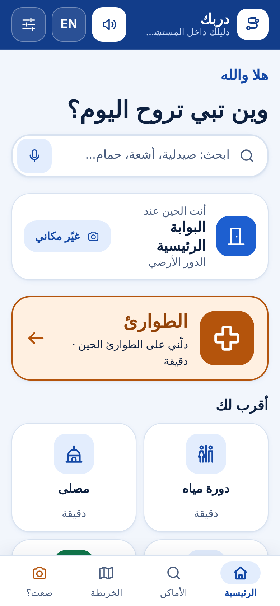
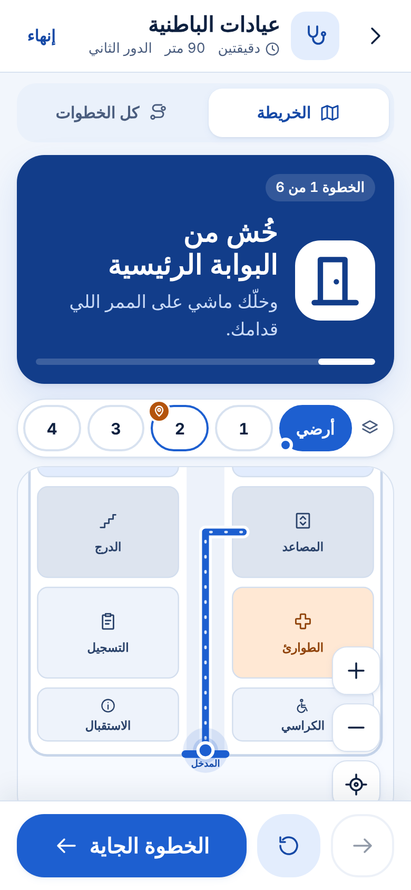
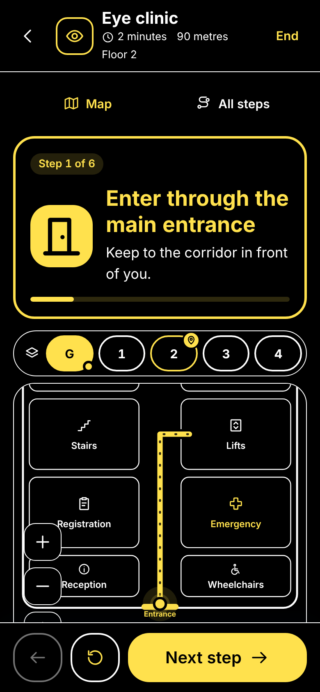

<div align="center">

# دربك · Darbak

**دليل داخلي للمستشفى بإرشاد صوتي سعودي، مصمم لكبار السن وأصحاب الهمم والزوار أول مرة.**

**An accessible, bilingual indoor-wayfinding web app for hospitals, with Saudi-Arabic voice guidance.**

[](https://github.com/najdhamed/Eng/actions/workflows/ci.yml)


Built for **MEDATHON 2026** · **[جرّب الموقع · Live demo](https://najdhamed.github.io/Eng/)**

</div>

<p align="center">
  
  
  
</p>

---

## المشكلة · The problem

المستشفيات الكبيرة متاهة: أدوار كثيرة، ممرات متشابهة، ولوحات صغيرة. كبير السن، ومستخدم الكرسي المتحرك، وضعيف النظر، والزائر اللي أول مرة يجي، كلهم يضيعون وقت ويتوترون قبل موعدهم.

Large hospitals are hard to navigate: many floors, identical corridors and small signs. Older patients, wheelchair users, people with low vision and first-time visitors lose time and get anxious on the way to their appointment.

## الحل · The solution

**دربك** يدلّك من مكانك لأي قسم، خطوة بخطوة، بصوت سعودي واضح:

> «امشِ سيدا 35 متر لين توصل المصاعد» → «اطلع بالمصعد للدور الثاني» → «لف يمين» → «لف يسار، وبتلقى عيادات الباطنية على يمينك» → «وصلت!»

|     | الميزة                                                                               | Feature                                                                                                  |
| --- | ------------------------------------------------------------------------------------ | -------------------------------------------------------------------------------------------------------- |
| 🧭  | مسارات حقيقية بخوارزمية Dijkstra على مخطط الأدوار                                    | Real shortest-path routing (Dijkstra) over a floor graph                                                 |
| 🗣️  | إرشاد صوتي باللهجة السعودية، يمين ويسار حسب اتجاهك الفعلي                            | Spoken turn-by-turn directions in Saudi Arabic, computed from the walker's real heading                  |
| ♿  | مسار بدون درج للكرسي المتحرك وعربية الأطفال (مضمون بالاختبارات)                      | Step-free routes for wheelchairs and strollers, guaranteed by tests                                      |
| 📍  | **تابع موقعي**: يطلب إذنك، ويتابع مشيك بالخطوات والـGPS، وينتقل للخطوة التالية لحاله | **Follow my location**: asks permission, follows your walk by steps and GPS, advances the step by itself |
| 🗺️  | خريطة تفاعلية لكل دور: تكبير، سحب، ونقطة «أنت هنا» تتحرك مع كل خطوة                  | Interactive floor maps with pan, pinch-zoom and a moving "you are here" dot                              |
| 📷  | **ضعت؟** صوّر رمز QR على أي لوحة، ويكمل الطريق من مكانك                              | **Lost?** Scan the QR code on any sign and the route restarts from where you stand                       |
| 🎙️  | بحث بالصوت وبحث ذكي يفهم «صيدليه» و«حمام» و«اسعاف»                                   | Voice search and fuzzy Arabic search ("صيدليه", "حمام", "اسعاف")                                         |
| 🚨  | زر طوارئ واحد، وأقرب دورة مياه ومصلى ومخرج من مكانك                                  | One-tap Emergency, and the nearest restroom, prayer room and exit                                        |
| 🔤  | خط كبير، تباين عالي، وضع داكن، عربي وإنجليزي (RTL/LTR)                               | Large text, high contrast, dark mode, Arabic and English                                                 |
| 🏷️  | صفحة للموظفين تطبع لوحات QR لكل قسم                                                  | A staff page that prints QR signs for every department                                                   |
| 📴  | يشتغل بدون إنترنت بعد أول فتح، وبدون تطبيق                                           | Works offline after the first visit (PWA), no app install                                                |
| 🔒  | لا حسابات ولا تتبع: كل شي محفوظ في جهازك                                             | No accounts and no tracking: everything stays on the device                                              |

---

## للجنة التحكيم · For the judges

**أسرع طريقة تشوفون فيها الشغل (5 دقايق):**

1. شغّلوا المشروع (الأوامر تحت) وافتحوه على الجوال أو بعرض جوال.
2. من الرئيسية اكتبوا «باطنية» واختاروا **عيادات الباطنية** → شوفوا الخريطة والخطوات واسمعوا الصوت.
3. غيّروا «كيف تتنقل؟» إلى **كرسي متحرك** من الإعدادات: المسار يتغير ويتجنب الدرج.
4. افتحوا **ضعت؟** ← «اختر المكان اللي تشوفه»، أو اطبعوا/افتحوا صفحة **لوحات QR** على جهاز ثاني وصوّروا أي لوحة.
5. جرّبوا **تباين عالي** و**خط كبير** و**English**.

**Where to look in the code:**

| What                                              | File                                                                                                                     |
| ------------------------------------------------- | ------------------------------------------------------------------------------------------------------------------------ |
| Floor graph and lift/stairs rules                 | [`src/navigation/graph.ts`](src/navigation/graph.ts)                                                                     |
| Dijkstra with a binary heap                       | [`src/navigation/dijkstra.ts`](src/navigation/dijkstra.ts), [`minHeap.ts`](src/navigation/minHeap.ts)                    |
| Turning a path into left / right / straight steps | [`src/navigation/directions.ts`](src/navigation/directions.ts)                                                           |
| Saudi-Arabic wording and Arabic plurals           | [`src/i18n/ar.ts`](src/i18n/ar.ts), [`plural.ts`](src/i18n/plural.ts), [`directionsText.ts`](src/i18n/directionsText.ts) |
| Arabic-aware search                               | [`src/search/searchPlaces.ts`](src/search/searchPlaces.ts)                                                               |
| QR decoding (BarcodeDetector + jsQR fallback)     | [`src/services/qr.ts`](src/services/qr.ts)                                                                               |
| The hospital data                                 | [`src/domain/hospital.ts`](src/domain/hospital.ts)                                                                       |
| Live tracking: route-constrained walking, steps   | [`src/navigation/tracking.ts`](src/navigation/tracking.ts), [`src/services/live.ts`](src/services/live.ts)               |
| Step counter and GPS odometer                     | [`src/services/motion.ts`](src/services/motion.ts), [`src/services/location.ts`](src/services/location.ts)               |
| Unit tests (128)                                  | `src/**/*.test.ts`                                                                                                       |
| End-to-end tests (79, phone browser)              | [`e2e/`](e2e)                                                                                                            |

---

## التشغيل · Getting started

Requires **Node.js 20+**.

```bash
git clone https://github.com/najdhamed/Eng.git
cd Eng
npm install
npm run dev          # http://localhost:5173
```

| Command                 | What it does                                                                                                                                                                                                                      |
| ----------------------- | --------------------------------------------------------------------------------------------------------------------------------------------------------------------------------------------------------------------------------- |
| `npm run dev`           | Development server with hot reload                                                                                                                                                                                                |
| `npm run build`         | Typecheck, then a production build in `dist/`                                                                                                                                                                                     |
| `npm run preview`       | Serve the production build                                                                                                                                                                                                        |
| `npm test`              | Unit tests (Vitest)                                                                                                                                                                                                               |
| `npm run test:coverage` | Tests with a coverage report                                                                                                                                                                                                      |
| `npm run test:e2e`      | Builds the app and drives it in a phone-sized Chromium (Playwright): location and motion permissions, the demo walk, offline, 320 px layouts, and axe WCAG scans in both languages. First time: `npx playwright install chromium` |
| `npm run lint`          | ESLint, including accessibility rules (jsx-a11y)                                                                                                                                                                                  |
| `npm run check`         | Typecheck + lint + unit tests, the same gate CI runs                                                                                                                                                                              |
| `npm run icons`         | Re-renders the home-screen icons from `public/favicon.svg`                                                                                                                                                                        |

To try voice search, the live camera and **Follow my location** on a phone, open the dev server over HTTPS or deploy it (browsers only allow the microphone, camera and location on secure origins). Without a phone, the consent sheet has a **Try a demo walk** button that follows a simulated walker along the route.

### The voice

Spoken directions use the voice that is installed on the visitor's phone (the browser's Web Speech API). Darbak asks for a Saudi Arabic voice (`ar-SA`) first, then any Gulf voice, then any Arabic voice, and says so in Settings when it had to settle for a closer one. No audio is shipped with the site and nothing is sent anywhere.

### Deploying

Every push to `main` runs CI and deploys to **GitHub Pages** (`.github/workflows/deploy.yml`). Enable it once under _Settings → Pages → Source: GitHub Actions_. The build uses relative paths, so `dist/` also works on any static host (Netlify, Vercel, S3, an intranet server).

---

## كيف يشتغل · How it works

```
Hospital data ──► Corridor graph ──► Dijkstra ──► Path ──► Steps ──► Words + voice
(rooms, doors)     (nodes, lifts,     (mobility-    (nodes,   (turn, metres,  (Saudi Arabic /
                    stairs)            aware cost)   edges)    side, floor)    English, TTS)
```

1. **Graph.** Each floor is a set of corridor points joined by walking edges (length in metres). Lifts link every floor directly; stairs link neighbouring floors. Wheelchair and stroller routes drop the stair edges entirely.
2. **Costs.** A lift ride costs a fixed wait plus a little per floor, a flight of stairs a fixed amount, so a walker takes the stairs for one floor and the lift for two or more.
3. **Directions.** Consecutive edges in the same direction are merged. The turn at each corner comes from the cross product of the walker's heading and the next direction, so "left" and "right" are always from the walker's point of view, including after leaving a lift (you exit facing the other way). The last walk also says which side the destination is on.
4. **Words.** Steps are structured data; `describeStep` turns them into a title, a detail and one spoken sentence per locale. Distances are rounded to 5 m and counted with Arabic plural rules (`مترين`، `5 أمتار`، `15 متر`).

More in [docs/ARCHITECTURE.md](docs/ARCHITECTURE.md) and [docs/ACCESSIBILITY.md](docs/ACCESSIBILITY.md).

## Project structure

```
src/
├── domain/        Hospital data, floor plate, geometry (no React)
├── navigation/    Graph, Dijkstra, directions, route planner (no React)
├── i18n/          Arabic + English messages, plurals, direction wording
├── search/        Arabic-normalising place search
├── services/      Speech, speech recognition, QR, storage, location, motion sensor, live tracker
├── state/         Preferences, journey and toast contexts
├── hooks/         useSpeech, useVoiceSearch, useWakeLock
├── components/    Map, floor switcher, search field, dialogs, controls
├── pages/         Home, Places, Route, Map, Lost, Settings, QR signs
└── styles/        Design tokens (light / dark / high contrast) and CSS
```

The routing and wording layers are plain TypeScript with no browser or React dependency, which keeps them fast to test and easy to move to a native app or a kiosk later.

## Roadmap

- Load hospital data from JSON exported from CAD floor plans, so a new hospital needs no code change.
- Bluetooth-beacon or Wi-Fi positioning, which would also replace the lift/stairs button with a real floor reading (web browsers have no barometer).
- Appointment hand-off: open Darbak from an SMS reminder straight to the right clinic.
- A natural Saudi voice: recorded clips, or a cloud neural voice (for example Azure `ar-SA`), as an alternative to the phone's own voice.
- Kiosk mode for lobby screens.

## الفريق · Team

فريق دربك، MEDATHON 2026 · The Darbak team, MEDATHON 2026

- **أثير** · Atheer
- **فاطمة** · Fatima
- **نجد** · Najd

## License

[MIT](LICENSE). The demo hospital, its departments and opening hours are fictional.
